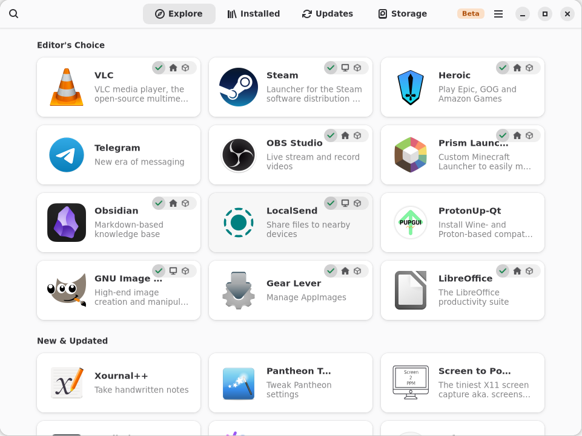
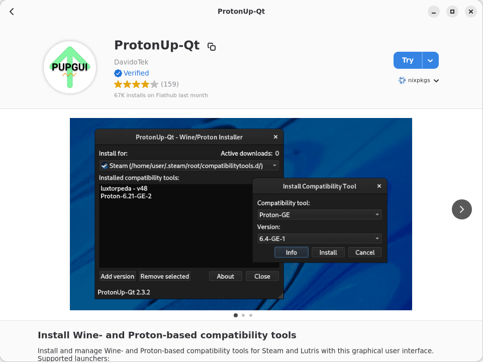
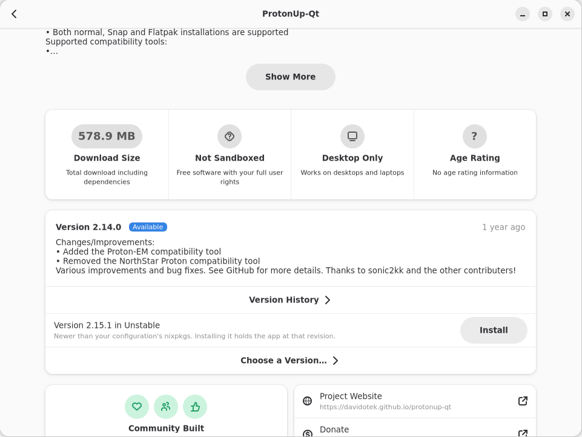
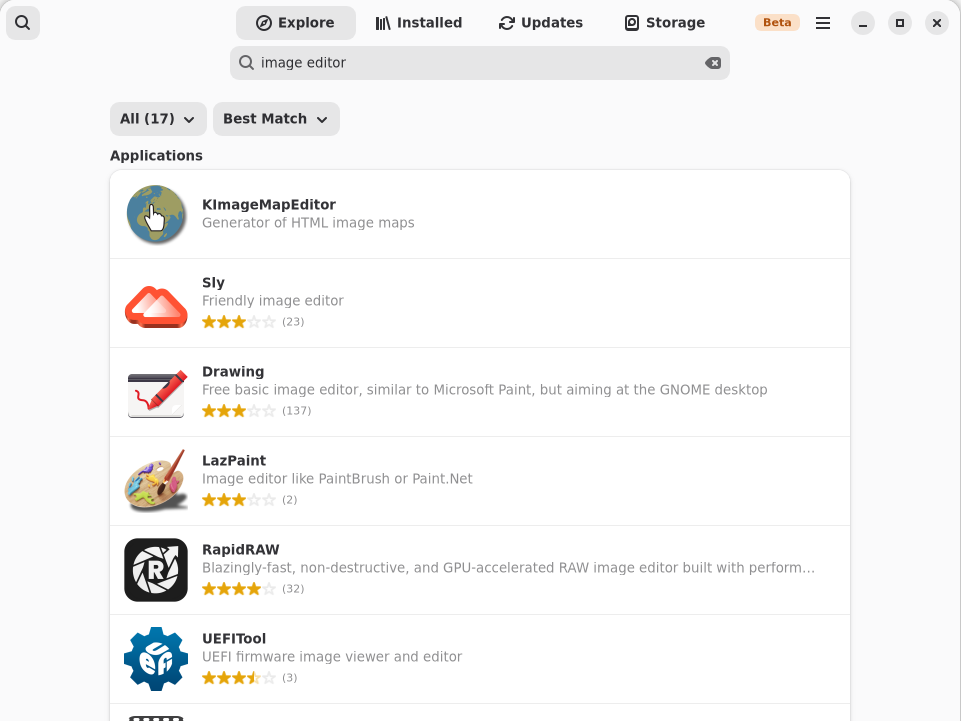
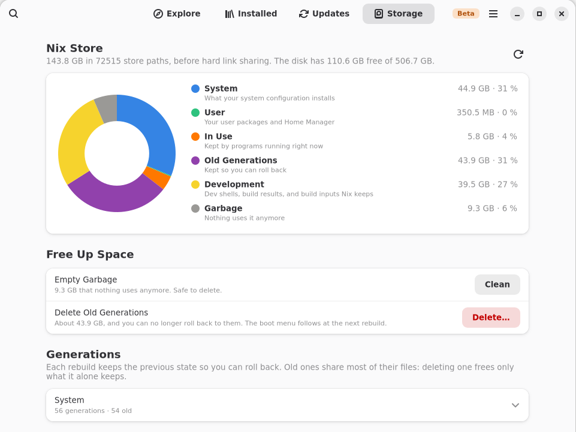

<p align="center">
  
</p>

<h1 align="center">Nix Software</h1>

<p align="center">
<em>a declarative app store for Nix, built around "try first"</em>
</p>

<hr/>
<br/>

<p align="center">
  <a href="https://github.com/SPTApyo/nix-software/actions/workflows/ci.yml"></a>
  <a href="https://github.com/SPTApyo/nix-software/releases"></a>
  <a href="https://github.com/SPTApyo/nix-software/blob/main/LICENSE"></a>
  
  <a href="https://github.com/SPTApyo/nix-software/commits/main"></a>
</p>

**Nix Software** is a GNOME Software style app store for NixOS and Home Manager. Launch any package from nixpkgs right away, nothing installed. When you want to keep it, Nix Software adds it to a small Nix module it generates, your configuration imports it, and you apply the usual way. Your own files are only touched after you accept a diff, and a backup is written first.

<p align="center">
  
</p>

<p align="center">
  
  
</p>

<p align="center">
  
  
</p>

## Features

- **Try first**: run any app with nix run, or open a nix shell for command line tools. Unfree packages included.
- **Keep**: the app goes into two small Nix files Nix Software owns, imported by your configuration, in your home or for everyone, as a package or through its NixOS or Home Manager module.
- **Knows your setup**: NixOS with or without flakes, Home Manager as a module or standalone, local and private configuration repositories. Elsewhere, it installs for your user with nix profile.
- **Sees what is installed**: by your configuration, by Nix Software, with nix profile or nix-env, as a Flatpak or an AppImage, and removes what it can.
- **Versions**: hold an app at any version nixpkgs shipped, or take a newer one from unstable.
- **Search**: packages of nixpkgs and of other flakes, NixOS and Home Manager options you can set, search by command, and results in the GNOME Shell overview.
- **Rich pages**: Flathub metadata (screenshots, ratings, age ratings) when the app exists there, else [nixsoftware.org](https://nixsoftware.org)'s, reviews, similar apps, build options.
- **Updates and Storage**: what a nixpkgs update changes for your apps, and where the store space goes, with clean-ups.
- **English and French** interface.

# Getting Started

Nix Software requires **Nix with flakes enabled**.

## Installation

Try it without installing:

```bash
nix run github:SPTApyo/nix-software
```

On NixOS with flakes, add the input and enable the module. It installs the
app, the GNOME Shell search provider and polkit, which applying needs:

```nix
# flake.nix
inputs.nix-software.url = "github:SPTApyo/nix-software";

# in your NixOS configuration
imports = [ inputs.nix-software.nixosModules.default ];
programs.nix-software.enable = true;
```

Once Nix Software is in nixpkgs, programs.nix-software.enable = true is
enough, without the input.

On NixOS without flakes, no channel needed:

```nix
environment.systemPackages = [
  (import (builtins.fetchTarball "https://github.com/SPTApyo/nix-software/archive/v0.2.1.tar.gz") { inherit pkgs; })
];
```

With Home Manager, put the same line in home.packages. For your user only,
without touching any configuration:

```bash
nix profile add github:SPTApyo/nix-software
```

GNOME Shell search only works once the app is installed in a profile.

From source:

```bash
git clone https://github.com/SPTApyo/nix-software.git
cd nix-software
nix build .   # result/bin/nix-software and result/bin/nix-software-cli
```

# Usage

New to Nix? The [user guide](docs/user-guide.md) explains how it all works, in plain words. The app also opens a welcome tour on first launch.

Open Nix Software from your app grid, or run nix-software.

A text interface ships next to the app:

```bash
nix-software-cli search gimp       # list matching packages
nix-software-cli run vlc           # try an app
nix-software-cli keep vlc          # add it to your configuration
nix-software-cli apply             # apply the configuration
nix-software-cli updates           # nixpkgs pin against its branch head
nix-software-cli versions vlc      # versions nixpkgs shipped
nix-software-cli layout --verify   # what Nix Software detects (read only)
```

nix-software-cli without arguments lists every command.
NIX_SOFTWARE_CONFIG_DIR points Nix Software to another NixOS configuration
folder, for example a copy to experiment safely.

## Contributing

See [CONTRIBUTING.md](CONTRIBUTING.md) to set up the project, and
[docs/](docs/README.md) for how it works.

# Community

For bugs, feature requests, and contributions, please use the [Issue Tracker](https://github.com/SPTApyo/nix-software/issues).

Made with ❤️ by [SPTApyo](https://github.com/SPTApyo).

# License

This software is distributed under the **GNU GPL-3.0-or-later**. See [LICENSE](LICENSE) for details.

Copyright (c) 2026 SPTApyo

The app icon combines two artworks:

- the bag from [GNOME Software](https://gitlab.gnome.org/GNOME/gnome-software), GPL-2.0-or-later, by the GNOME Software authors;
- the snowflake from [NixOS artwork](https://github.com/NixOS/nixos-artwork), [CC-BY-4.0](https://creativecommons.org/licenses/by/4.0/), by the NixOS project.
