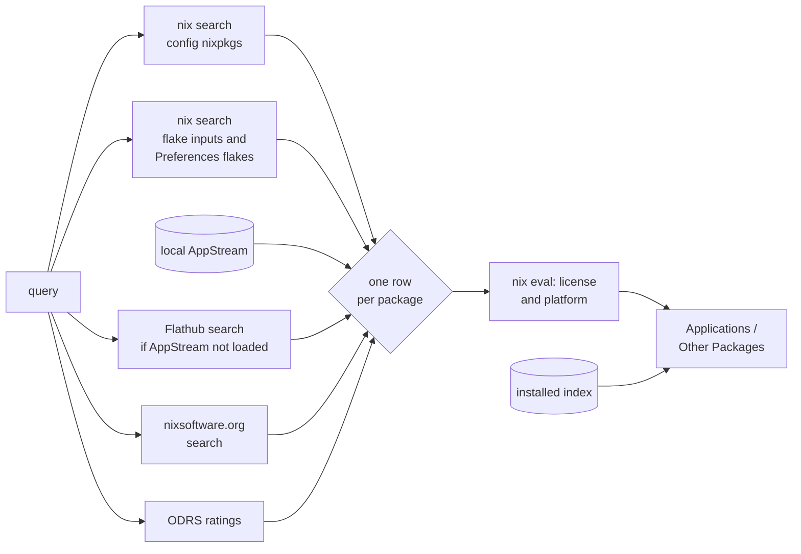
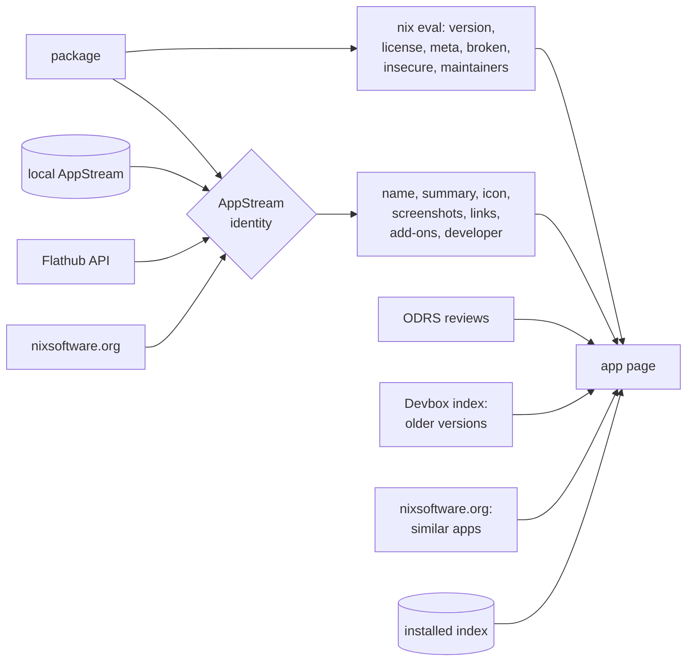
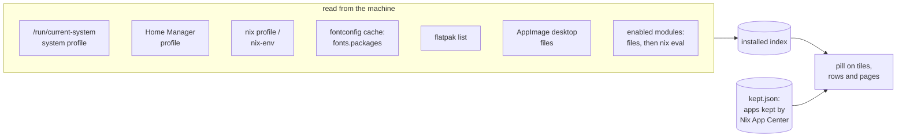

# Design

Why Nix App Center works the way it does. The code says what it does; these
notes keep the reasons.

## Principles

- **Try first.** Running a package with nix run is the primary action. Keeping
  it is a deliberate second step.
- **Nix App Center never overwrites anything.** It owns two generated files. Its
  only change to a file the user wrote is one import line, added once, after
  showing the exact diff, with explicit consent, and removable later.
- **No silent magic.** When Nix App Center cannot tell where the configuration
  lives, it shows the snippet to paste and stops there.
- **The network is optional.** Flathub, ODRS, Devbox and nixsoftware.org only provide
  metadata (icons, screenshots, ratings, version history). Every call has a
  short timeout and a silent fallback; running and installing always go
  through Nix.

## Architecture

```text
crates/core   all the logic, no UI dependency
crates/gui    GTK 4 and libadwaita front end, written with relm4
crates/cli    text front end over the core
nix/          the nixpkgs recipe, the NixOS module and its test
```

The core models packages and actions as data (Package, Action, actions_for)
so each front end renders the same logic its own way.

## Where the data comes from

Nothing is fetched twice in a row: nix search results, the AppStream file
and Flathub answers are cached on disk ($XDG_CACHE_HOME/nix-app-center), and
every network call has a short timeout and falls back silently.

### Search



Each package takes its app identity from the first source that knows it:
the local AppStream data (through the user and community mappings, see
Package identity), then a Flathub hit, then nixsoftware.org. One app id
belongs to one package; a Flathub guess never takes an id the local data
already gave. A package nobody recognizes stays in Other Packages under its
attribute name. Packages that do not build for this machine are dropped.

### App page



AppStream data wins for what describes the app (name, description,
screenshots, links). Nix wins for what runs: the version, whether it is
broken or insecure, the license when AppStream has none. The version list
follows nixpkgs, with Flathub release notes only for versions nixpkgs ships.

### What is installed



The index says where an app is (system, home, Flatpak, AppImage) and
whether a module brings it; the manifest says whether Nix App Center owns
it. Details follow in What is installed.

## How a Nix machine keeps its software

Nix App Center has to handle every common setup. What matters is where
packages are declared, where they end up once applied, and where the nixpkgs
revision is pinned.

| Setup | Declared in | Ends up in | nixpkgs pinned by | Apply | Update nixpkgs |
| --- | --- | --- | --- | --- | --- |
| NixOS, flake | environment.systemPackages | /run/current-system/sw | flake.lock of the system flake | nixos-rebuild switch --flake dir#host | nix flake update nixpkgs --flake dir, then apply |
| NixOS, channels | environment.systemPackages | /run/current-system/sw | root channel nixos | nixos-rebuild switch | nixos-rebuild switch --upgrade |
| NixOS user packages | users.users.NAME.packages | /etc/profiles/per-user/NAME | same as the system | same as the system | same as the system |
| Home Manager as a NixOS module | home-manager.users.NAME home.packages | /etc/profiles/per-user/NAME or ~/.nix-profile | the system nixpkgs or its own | same as the system | same as the system |
| Home Manager standalone, flake | home.packages | ~/.nix-profile | ~/.config/home-manager/flake.lock | home-manager switch --flake dir | nix flake update nixpkgs --flake dir, then apply |
| Home Manager standalone, channels | home.packages | ~/.nix-profile | user channels | home-manager switch | nix-channel --update, then apply |
| nix profile, nix-env | imperative | ~/.nix-profile | per package | none | nix profile upgrade |
| nix run, nix shell (Try) | nothing | store only, no GC root | the configuration's nixpkgs | none | none |

Facts that hold without evaluating anything:

- A profile is a store path whose references are the packages in it, through
  buildEnv layers (user-environment, home-manager-path, system-path). The
  store path name of a package gives its pname and version.
- nixos-version --json gives the nixpkgs revision the system was built from.
- A flake.lock holds every transitive input. The node whose locked rev
  matches that revision tells the branch it follows and whether it is a
  direct input of the root flake (updatable there) or comes through another
  flake (updated in that flake).
- A store path no GC root reaches is dead. nix store delete removes dead
  paths only, so deleting a tried app never breaks the system. With
  keep-outputs and keep-derivations set, the deriver .drv goes with its
  outputs.

## Reading the configuration

The layout is detected by scanning text, never by parsing Nix
(crates/core/src/config_layout.rs): NixOS flake, NixOS with channels, Home
Manager as a flake or standalone, or unknown. The host is the
nixosConfigurations entry named like the machine, whatever its case.
Preferences can override the folder and the host, and check the result with
Nix itself. NIX_APP_CENTER_CONFIG_DIR overrides the folder too; the tests use
it so they never touch /etc/nixos.

Nix App Center writes nix-app-center-home.nix and nix-app-center-system.nix from
its manifest, kept.json. On NixOS both are imported from the imports list of
configuration.nix; a flake without configuration.nix gets them in the
modules list of flake.nix. When Home Manager is a NixOS module, the home file
wraps its content in home-manager.users.NAME; without Home Manager it fills
users.users.NAME.packages. In a git repository the files are added with
git add --intent-to-add, or a flake would not see them.

Files the user cannot write go through one pkexec call, so the password is
asked once per change: the content travels inside the script, each file goes
through mktemp in its own folder, and root runs with the system PATH only.
The Nix files are written before the manifest, so a refused password leaves
everything as it was.

A plain kept app is one entry of the aggregated package list. An app with
its own Nix (advanced editor, module, option) gets its own module region,
between nix-app-center:begin and nix-app-center:end markers. Each region is a
separate module, so two blocks defining the same option merge instead of
clashing. The advanced editor checks syntax on every keystroke
(nix-instantiate --parse, about 50 ms) and offers a dry build on demand.

## Applying

An apply is a list of steps run in order, stopping at the first failure; an
update is two: refresh the lock or channel, then apply. A step starting with
sudo runs through pkexec, so the password prompt is graphical; pkexec gets a
SHELL listed in /etc/shells, or it refuses.

A NixOS flake switch is split in two. nixos-rebuild build runs as the user in
a fresh private folder, then root only activates the result (nix-env sets
the system profile, switch-to-configuration switches to it). Root can read
neither a git repository it does not own nor the user's credentials, so
building as root fails on a configuration kept in a private repository. The
result is checked to be a plain store path before root runs anything from
it.

Flake inputs that point to a local folder (git+file, path) are passed again
with --override-input, so the build uses the files on disk, uncommitted
changes included. That covers a small /etc/nixos flake importing the real
configuration from the home folder. Setups the detection cannot guess can
set their own apply command in Preferences.

Progress comes from --log-format internal-json (crates/core/src/progress.rs):
copy and build activities carry done and expected counts, which give the
percentage, and the time left extrapolates once five percent is done.
Evaluation and activation report no counts, so the bar pulses there. Plain
text logs (a custom command, Home Manager) are counted from their "these N
paths will be fetched" and "copying path" lines. The last error line of a
failure becomes the message shown.

Every change to the configuration leaves a marker in the data folder, and a
successful apply removes it: while it is there, an Apply button shows in the
header bar. A closed dialog keeps working and a desktop notification reports
the end when the app is not in front.

## What is installed

One index answers for tiles, search rows and app pages
(crates/core/src/installed.rs). It is read at most every five seconds, and
again after each apply, which also redraws every pill on screen. It reads:

- the references of each profile, so command line tools, fonts and themes
  count; fonts.packages come from the fontconfig cache file, since they stay
  out of the system profile;
- the desktop files of the profiles, for the names apps go by (steam ships
  steam.desktop but resolves to steam-unwrapped);
- flatpak list, and desktop files in ~/.local/share/applications that run an
  AppImage (crates/core/src/foreign.rs).

An app matches by pname, desktop file name or Flathub app id. A nested
attribute such as haskellPackages.Obsidian must match the version too, or
every package named like an installed app would match.

Whether an app comes from a module is first read from the files: any
X.enable not set to false in the .nix files of the configuration and of its
local inputs. That guess is instant and works on a configuration that does
not evaluate. Nix then evaluates which of those names are really enabled, in
the background, and the answer is cached until a file changes
(crates/core/src/enabled.rs).

An app installed but not kept by Nix App Center is looked up in the user's
files: the line listing it in a packages or systemPackages definition, lists
combined with ++ and with pkgs; included. Its page names the file and line
and offers Take Over: the app is kept, and the user deletes their own line.
The trash button removes only what Nix App Center can: a kept app, a nix
profile or nix-env install, a Flatpak, an AppImage (after naming both files
it deletes), a tried app.

When the installed version is neither the nixpkgs one nor an older one
waiting for an apply, the configuration changes the app, usually with an
overlay: the page says so, and Updates leaves it alone.

Removing a tried app deletes its dead closure, minus what other tried apps
need and minus anything a dead path outside that set still refers to.

## Keeping an app

A kept app is installed in the user's home, in the system packages, through
its NixOS module (X.enable = true in its system block) or through its Home
Manager module (the same line in its home block). A module counts when its
package option defaults to the package (programs.steam.package = pkgs.steam)
or when it is named after it (programs.gamemode); Home Manager's options come
from its docs-json package. When the app has a module, Add to Configuration
asks where and how first, waiting a few seconds at most for the lookup, so
the choice is made once. Installation Options changes it later; the module
offered follows the place, NixOS for everyone, Home Manager for the home.
Custom blocks say more than a mode and are left alone.

Build options are the boolean arguments of the package recipe (withQt5 ?
true in vlc), read from the file meta.position points to, since Nix gives the
argument names but not their defaults. They only show for an app kept as a
plain package: a module installs its own build. Changing one builds the app
locally, since the binary cache only holds the default build.

Holding a version takes the app from another nixpkgs revision. The hold
records that revision, the hash of its tarball and the day it started; the
generated file imports each held revision once:

```nix
nixpkgs-cf5e76507c6e = import (builtins.fetchTarball {
  url = "https://github.com/NixOS/nixpkgs/archive/<rev>.tar.gz";
  sha256 = "<hash>";
}) {
  config = lib.filterAttrs (_: v: v != null) pkgs.config;
  system = pkgs.stdenv.hostPlatform.system;
};
```

fetchTarball works with flakes and channels without editing flake.nix; pure
evaluation needs the hash, computed once with nix-prefetch-url --unpack.
Passing pkgs.config whole fails, since its unset options are null and no
longer type check. Overlays of the main nixpkgs do not apply to the held one.
Held apps leave Updates, and their page warns that they get no security
updates, more strongly after 30 days.

The versions to choose from come from the Devbox package index
(search.devbox.sh): each one with the nixpkgs revision that shipped it, and
a request to cache.nixos.org says whether it downloads or builds. Only the
package name is sent. When nixos-unstable has a newer version, the page
offers it as a hold at the unstable revision.

## Package identity

nixpkgs and Flathub have no official mapping. Nix App Center matches them in
this order: the user overlay ($XDG_DATA_HOME/nix-app-center/app-mapping.json,
filled by Wrong App?), the community overlay
(crates/core/src/data/app_mapping.json), then name heuristics. A heuristic
key is dropped when an overlay pins that attribute to another app (nixpkgs
moonlight is a Discord client, not the game streaming app). When several
attributes share one AppStream entry (gimp, gimp3), only the best ranked one
takes the app identity.

nixsoftware.org curates apps by nixpkgs attribute. It fills what the
AppStream data misses, never overrides it: a search result neither the local
database nor Flathub recognizes takes its name and logo from there, and so
does a details page. Its Similar Apps section lists that site's suggestions
nixpkgs has for this machine. Every request names the app in its User-Agent,
as the site asks.

AppStream data comes from Flatpak's local appstream.xml.gz when Flatpak is
installed, else from the same file downloaded from Flathub and refreshed in
the background once a day. It loads in a background thread at startup; a
details page waits for it, bounded, because it holds what the REST API lacks
(add-ons, apps by the same developer).

The version section follows nixpkgs, not Flathub. Flathub's release list
starts at the release equal to the nixpkgs version, so releases Nix cannot
install are left out; without such a release, the history comes from the
Devbox index. Add-ons have no nixpkgs attribute: opening one searches
nixpkgs for its name, preferring the parent's package set (gimpPlugins for
gimp).

## Search

Search runs nix search on the configuration's nixpkgs revision, plus, side by
side, the GitHub, GitLab and sourcehut inputs of its flake.lock (nixpkgs and
plumbing aside) and the flakes added in Preferences. Packages from an input
are written as inputs.NAME.packages.SYSTEM.ATTR, so the configuration must
pass inputs through specialArgs; flakes added in Preferences are written as
builtins.getFlake with a locked revision instead, which needs no change to
the flake. Names coming from other flakes are written only when they are
plain identifiers, since they end up in Nix run as root.

Results then get their license and platform from one evaluation for the
whole page. Packages that do not build for this machine
(lib.meta.availableOn) are hidden, so an ARM computer never lists x86 only
software.

NixOS options, Home Manager options and the modules searched flakes ship
are listed too. Setting one writes NAME = VALUE; in its own module region,
in the system or home file. The name must be a plain attribute path; the
value is the user's own Nix.

## Updates

Updates reads the nixpkgs revision the system runs, finds its branch in the
configuration's flake.lock, asks nix flake metadata for the branch head and
evaluates the versions the head ships for the installed apps. Updating moves
the pin and applies. When nixpkgs comes through another flake input, Nix App
Center says which one and leaves it. Without a managed configuration
(other Linux distributions), it compares the apps of ~/.nix-profile and
updates with nix profile upgrade.

## Storage

The Storage tab reads every store path once (nix path-info --all --json) and
the GC roots, then walks the reference graph in memory. Each path counts in
the first category that reaches it, so the chart adds up to the store: the
current system, user environments, running programs, old generations,
development (other roots, and build inputs keep-outputs keeps alive), tried
apps, and garbage, which is only what nothing keeps alive. A generation's
figure is what only it reaches.

## Integration

- Settings live in $XDG_CONFIG_HOME/nix-app-center/settings.json. Reading
  reviews is anonymous; a random id is only used to post one.
- The GNOME Shell search provider answers from the local AppStream database
  only, so it never waits on the network.
- nixpkg://ATTR links, the Install button of nixsoftware.org, open the app
  page of ATTR. Only plain attrs are accepted, and the link never installs
  anything by itself.
- Nix App Center is single instance: on its own page, Try and Open would only
  raise the window already open, so they say so instead.
- A welcome tour opens on first launch and stays in the main menu.
- Translations use gettext, driven by the system locale like GNOME Software.
  Core strings shown in the UI are marked with n_() and translated where
  they are displayed.
- cargo run -p nix-app-center-gui --features dev-gallery adds a Gallery tab of
  labeled scenarios opening the real views; it is absent from release
  builds.
